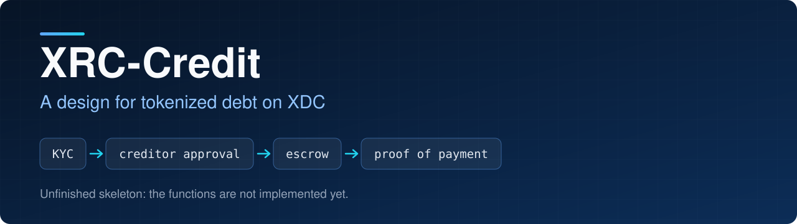
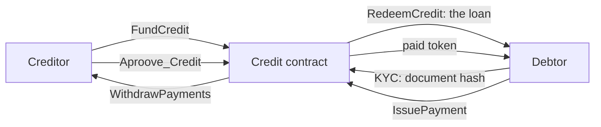

<p align="center">
  
</p>

<p align="center">
  
<a href="https://github.com/CoinClubQuincy/XRC-Credit/actions/workflows/build.yml"></a>        
</p>

<p align="center">
  <a href="#how-it-works">How it works</a> · <a href="#what-is-tested">What is tested</a> · <a href="#try-it">Try it</a>
</p>

XRC-Credit is a single loan as a contract. A creditor lends in XDC or an XRC-20 token, the debt is a token that can be sold, and full repayment gives the debtor a token proving it was paid.

> [!WARNING]
> **This is a proof of concept.** It has no default handling, no collateral and no late penalties, so nothing happens if the debtor stops paying. It has not been audited and has not run on a real network.

## How it works




| File | Contract | Pays in |
| --- | --- | --- |
| [`contracts/CreditBase.sol`](contracts/CreditBase.sol) | `CreditBase` | Shared rules |
| [`contracts/XRC-Credit.sol`](contracts/XRC-Credit.sol) | `XRCCredit` | An XRC-20 token. Approve the contract first |
| [`contracts/XDC-Credit.sol`](contracts/XDC-Credit.sol) | `XDCCredit` | XDC. Send the exact amount |

The constructor takes `(uri, principal, interestBps, debtor, creditor)`, plus the token address for `XRCCredit`. Interest is a flat amount set at the start: 1000 basis points on a principal of 100 means 110 is owed.

| Function | Who | Allowed in | What it does |
| --- | --- | --- | --- |
| `FundCredit()` | Holder of token 0 | Created | Puts the principal in the contract |
| `KYC(documentHash)` | Debtor | Created, Funded | Stores a hash of the debtor's documents |
| `Aproove_Credit(status)` | Holder of token 0 | Funded, Approved | Approves the debtor once funded and filed, or withdraws approval |
| `RedeemCredit()` | Debtor | Approved | Sends the principal to the debtor, once |
| `IssuePayment(amount)` | Debtor | Active | Repays. Paying more than is owed is refused, and the last payment mints token 1 to the debtor |
| `WithdrawPayments()` | Holder of token 0 | Any | Collects the repayments made so far |
| `CancelCredit()` | Holder of token 0 | Created, Funded, Approved | Ends the credit and returns any funding |

Token 0 is the debt. Selling it moves the right to future repayments, and any repayments not yet withdrawn, to the buyer.

> [!IMPORTANT]
> `KYC` stores only a hash, so never put personal data on-chain. Add a random salt to what you hash, because a hash of predictable data can be guessed. Checking the documents behind the hash happens off-chain.

## Try it

```bash
git clone https://github.com/CoinClubQuincy/XRC-Credit.git
cd XRC-Credit
git clone --depth 1 -b v4.9.6 https://github.com/OpenZeppelin/openzeppelin-contracts lib/openzeppelin-contracts
git clone --depth 1 -b v1.9.7 https://github.com/foundry-rs/forge-std lib/forge-std
forge test
```

You need [Foundry](https://getfoundry.sh).

## What is tested

[`test/foundry/Credit.t.sol`](test/foundry/Credit.t.sol) has 23 test functions and runs in CI on every push. The shared ones run against both variants, so `forge test` reports 41 results.

| Tested | Not tested |
| --- | --- |
| A full loan from funding to proof of payment, in both variants | A real network, testnet or mainnet |
| Who may call each function, and calls in the wrong state | An independent security audit |
| Overpayment, wrong amounts and redeeming twice | Tokens that take a fee, which are refused rather than supported |
| Selling the debt, and cancelling with a refund | |
| A reentrant debtor and a reentrant creditor | |
| Fuzz: money in equals money out for any principal, interest and first payment | |

## Changes from earlier versions

The earlier version was a skeleton with empty functions, so there is nothing to migrate.

- The contract was implemented. The constructor now also takes `interestBps`, and `XRCCredit` takes a token address.
- `KYC` takes a document hash, and `IssuePayment` takes an amount.
- `XDC-Credit.sol` was an empty file. It now holds `XDCCredit`.
- Tracked build output was removed.

## Known issues

| Issue | Effect |
| --- | --- |
| No default handling | If the debtor stops paying, the contract does nothing. Any recovery has to happen outside it |
| No due dates | Payments can arrive at any time, and interest does not grow |
| A debtor contract must accept ERC-1155 tokens | The final payment mints the paid token, so it reverts if the debtor is a contract that cannot receive it |
| The paid token can be transferred | It proves a payoff happened, not who holds it now. Check `state` and `Debtor` as well |
| The creditor can cancel until the debtor redeems | Approval is not a promise to lend |

<details>
<summary><strong>More XDC projects</strong></summary>

| Group | Project | What it is |
| --- | --- | --- |
| Standards | [XRC-SHARES](https://github.com/CoinClubQuincy/XRC-SHARES) | Dividend-paying NFT shares and SPLITS for a DApp |
| Standards | [XRCDividendPlus](https://github.com/CoinClubQuincy/XRCDividendPlus) | Dividend-paying XRC-20 token |
| Treasury and finance | [Multi-Sig-Treasury](https://github.com/CoinClubQuincy/Multi-Sig-Treasury) | Treasury controlled by tokenized keys |
| Treasury and finance | [XRC-Airdrop](https://github.com/CoinClubQuincy/XRC-Airdrop) | Self-run token airdrop |
| Treasury and finance | [XDC-Defi-Instruments](https://github.com/CoinClubQuincy/XDC-Defi-Instruments) | Assets, agreements, forwards, futures and a marketplace |
| Identity and access | [LoginMFAContract](https://github.com/CoinClubQuincy/LoginMFAContract) | Login with a password and an NFT |
| Identity and access | [PrivateAccessToken](https://github.com/CoinClubQuincy/PrivateAccessToken) | Token-gated contract data demo |
| Identity and access | [Delegated_Authority](https://github.com/CoinClubQuincy/Delegated_Authority) | KYC notary proof of concept |
| Learning and libraries | [XDC-LemonadeStand](https://github.com/CoinClubQuincy/XDC-LemonadeStand) | Workshop DApp built on XRC-SHARES |
| Learning and libraries | [Non-Financial-SmartContracts](https://github.com/CoinClubQuincy/Non-Financial-SmartContracts) | Games, inventory, keys and on-chain repositories |
| Tools | [XDC_Python_SDK_V1](https://github.com/CoinClubQuincy/XDC_Python_SDK_V1) | Python client for the XDC JSON-RPC API |
| Tools | [PrivateXDCNode_SetupScript](https://github.com/CoinClubQuincy/PrivateXDCNode_SetupScript) | Private XDC network setup scripts |
| Tools | [WebApp_to_XDCPay](https://github.com/CoinClubQuincy/WebApp_to_XDCPay) | Web app to XDCPay tutorial |
| Multi-chain | [CoinClub_Framework](https://github.com/CoinClubQuincy/CoinClub_Framework) | Python library with an XDC adapter |
| Interfaces | [Contract_Interface_Model_Language](https://github.com/CoinClubQuincy/Contract_Interface_Model_Language) | Interface documents for smart contracts and APIs |

</details>

## License

[MIT](LICENSE).
