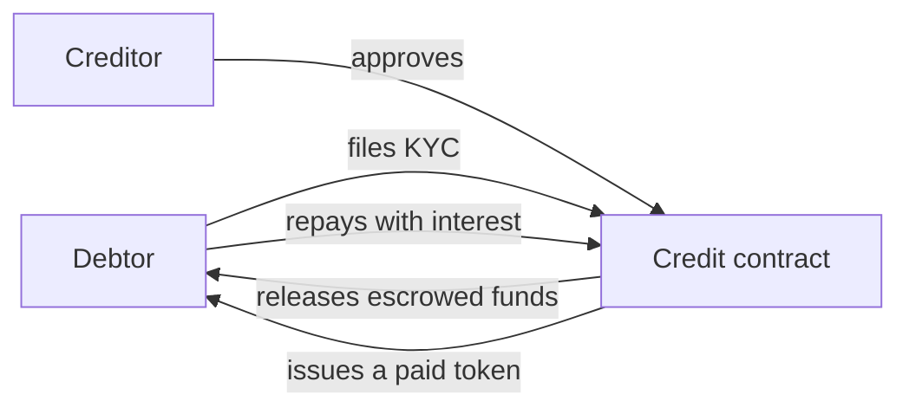

<p align="center">
  
</p>

<p align="center">
  
<a href="https://github.com/CoinClubQuincy/XRC-Credit/actions/workflows/build.yml"></a>        
</p>

<p align="center">
  <a href="#the-design">The design</a> · <a href="#current-state">Current state</a> · <a href="#try-it">Try it</a>
</p>

XRC-Credit sketches a contract where one party lends in XDC or an XRC token, the debt is represented by a token, and repayment produces proof that it was paid.

> [!WARNING]
> **This is a skeleton and can't be used to lend or repay.** The contract compiles, but its main functions are empty. It is published to show the design.

## The design




| Planned feature | Current state |
| --- | --- |
| Tokenized ownership of the debt | The deployer receives a credit token. Nothing else uses it yet |
| KYC and approval | `KYC()` is empty, and `Aproove_Credit()` doesn't change anything |
| Escrow and interest | Not implemented |
| A token proving the debt was paid | Not implemented |

## Current state

[`test/foundry/Credit.t.sol`](test/foundry/Credit.t.sol) has 4 tests that pin what the contract does today, and they run in CI on every push.

| Behaviour | Test |
| --- | --- |
| The deployer holds the credit token | `test_DeployerHoldsTheCreditToken` |
| The amount, debtor and creditor passed to the constructor aren't stored | `test_KnownIssue_ConstructorArgumentsAreNotStored` |
| Approval uses `==` instead of `=`, so nothing changes | `test_KnownIssue_ApprovalDoesNotChangeState` |
| The named debtor is locked out, because `Debtor` is never set | `test_KnownIssue_TheNamedDebtorIsLockedOut` |

## Try it

```bash
git clone https://github.com/CoinClubQuincy/XRC-Credit.git
cd XRC-Credit
git clone --depth 1 -b v4.9.6 https://github.com/OpenZeppelin/openzeppelin-contracts lib/openzeppelin-contracts
git clone --depth 1 -b v1.9.7 https://github.com/foundry-rs/forge-std lib/forge-std
forge test
```

You need [Foundry](https://getfoundry.sh). Tests named `test_KnownIssue_*` pass because they pin a defect, so a passing run does not mean the defect is gone.

<details>
<summary><strong>More XDC projects</strong></summary>

| Group | Project | What it is |
| --- | --- | --- |
| Standards | [XRC-SHARES](https://github.com/CoinClubQuincy/XRC-SHARES) | Dividend-paying NFT shares and SPLITS for a DApp |
| Standards | [XRCDividendPlus](https://github.com/CoinClubQuincy/XRCDividendPlus) | Dividend-paying XRC-20 token |
| Treasury and finance | [Multi-Sig-Treasury](https://github.com/CoinClubQuincy/Multi-Sig-Treasury) | Treasury controlled by tokenized keys |
| Treasury and finance | [XRC-Airdrop](https://github.com/CoinClubQuincy/XRC-Airdrop) | Self-run token airdrop |
| Treasury and finance | [XDC-Defi-Instruments](https://github.com/CoinClubQuincy/XDC-Defi-Instruments) | Assets, agreements, forwards, futures and a marketplace |
| Identity and access | [LoginMFAContract](https://github.com/CoinClubQuincy/LoginMFAContract) | Login with a password and an NFT |
| Identity and access | [PrivateAccessToken](https://github.com/CoinClubQuincy/PrivateAccessToken) | Token-gated contract data demo |
| Identity and access | [Delegated_Authority](https://github.com/CoinClubQuincy/Delegated_Authority) | KYC notary proof of concept |
| Learning and libraries | [XDC-LemonadeStand](https://github.com/CoinClubQuincy/XDC-LemonadeStand) | Workshop DApp built on XRC-SHARES |
| Learning and libraries | [Non-Financial-SmartContracts](https://github.com/CoinClubQuincy/Non-Financial-SmartContracts) | Games, inventory, keys and on-chain repositories |
| Tools | [XDC_Python_SDK_V1](https://github.com/CoinClubQuincy/XDC_Python_SDK_V1) | Python client for the XDC JSON-RPC API |
| Tools | [PrivateXDCNode_SetupScript](https://github.com/CoinClubQuincy/PrivateXDCNode_SetupScript) | Private XDC network setup scripts |
| Tools | [WebApp_to_XDCPay](https://github.com/CoinClubQuincy/WebApp_to_XDCPay) | Web app to XDCPay tutorial |
| Multi-chain | [CoinClub_Framework](https://github.com/CoinClubQuincy/CoinClub_Framework) | Python library with an XDC adapter |
| Interfaces | [Contract_Interface_Model_Language](https://github.com/CoinClubQuincy/Contract_Interface_Model_Language) | Interface documents for smart contracts and APIs |

</details>

## License

[MIT](LICENSE).
